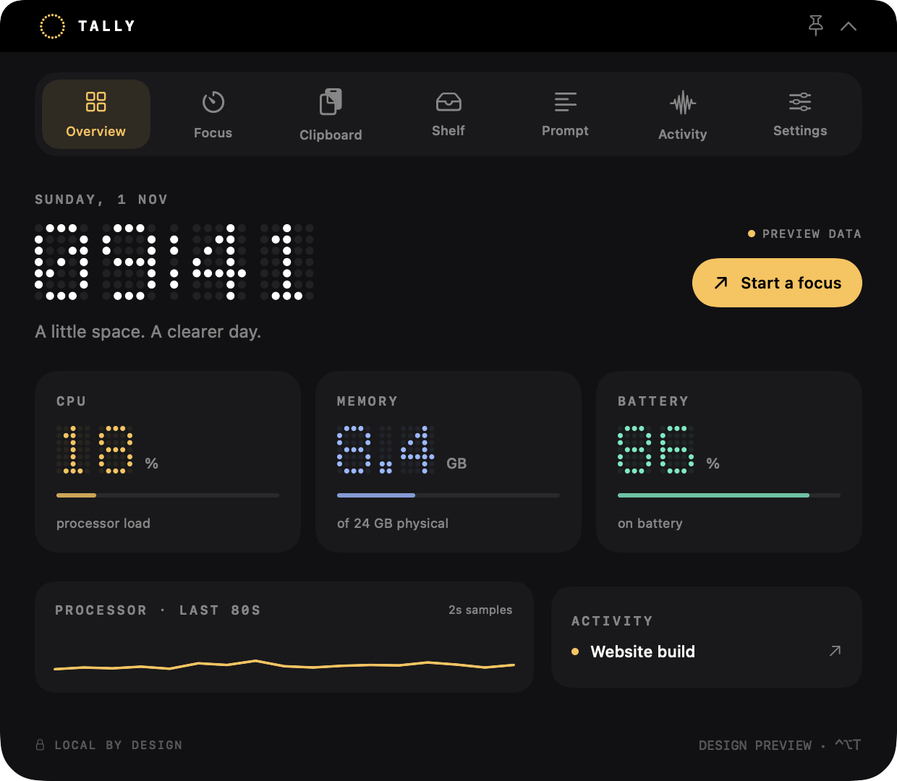
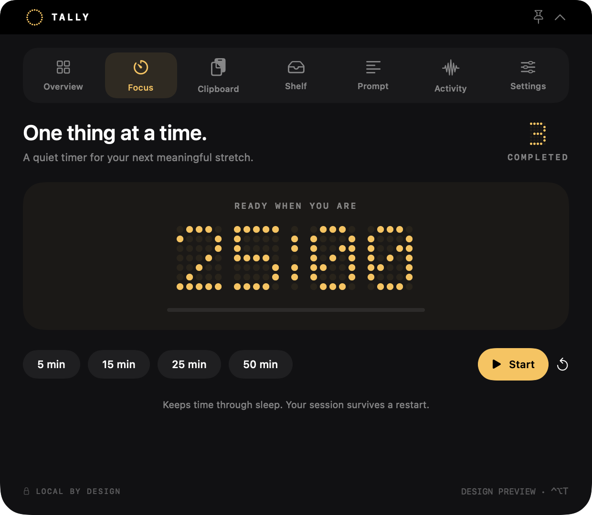

# Tally Island

**A little space. A clearer day.**

A native macOS island with dot-matrix numbers, real system readings, and small tools that keep your work moving. Built with SwiftUI and AppKit, with no third-party runtime dependencies.



*Rendered from the actual interface with labeled sample data. v0.1.0 is a developer preview, not a claim of feature parity with mature island apps.*

## What works today

- **Dot-matrix numbers:** an original circle-drawn renderer for time, CPU, memory, battery, focus and reported tokens. Amber, Mint and Ice accents.
- **System overview:** CPU load/history, approximate active + wired + compressed memory, internal battery and free disk space. Updates every two seconds.
- **Focus:** 5, 15, 25 or 50 minutes; pause, resume, reset, completion sound and persistent deadline. Time remains correct across sleep and relaunch.
- **Clipboard:** opt-in, searchable, text-only history; up to 30 clips in memory. Known secret patterns and password-manager markers are skipped. Filtering is not a guarantee that every secret will be detected.
- **File shelf:** add/drop up to 20 file references; open, reveal, remove and drag out. Removing a reference does not delete the original file.
- **Teleprompter:** an editable script, paced phrase reading, manual navigation and 60–240 words per minute. No microphone required.
- **Activity bridge:** use `tally` to show working/waiting/done/failed states, progress, and explicitly reported token counts. No automatic account access or agent configuration changes.
- **Native shell:** compact/expanded panel, hover opening, pinning, menu-bar controls and **Control–Option–T**. **Esc** collapses the panel.



## Install the preview

Unzip the package, move **Tally Island.app** to Applications, and open it. Use the dotted-circle menu-bar icon or **⌃⌥T** to open the island. Quit other island overlays while trying Tally so their hit areas do not overlap.

The preview is ad-hoc signed, not Developer ID signed or notarized. A downloaded build may require the normal **System Settings → Privacy & Security → Open Anyway** flow. No quarantine-disabling commands are required by this project. Alternatively, build locally from source.

**Requirements:** macOS 14+, Apple Command Line Tools with a Swift compiler to build. The supplied local package is Apple silicon. Other supported OS versions and Intel builds require further hardware validation; see [VALIDATION.md](docs/VALIDATION.md).

## Build and test

```bash
./scripts/build.sh
./scripts/test.sh
./scripts/package.sh
open 'dist/Tally Island.app'
```

Build scripts use `swiftc` directly, so the full Xcode app and Swift Package Manager are not required. There are no package downloads. The build outputs the app executable and the `tally` command under `.build/bin`. CI builds, tests and packages on a macOS runner; the workflow's presence is not evidence of a completed remote run.

`TALLY_BUILD_DIR` and `TALLY_DIST_DIR` can place build/package outputs elsewhere. `TALLY_ARCH=x86_64` requests an Intel cross-build; that alone is not runtime validation. `--preview` opens the app as a centered, pinned panel for UI testing. `--render-preview PATH` renders labeled sample-data documentation images and exits.

## Connect a workflow

```bash
'/Applications/Tally Island.app/Contents/MacOS/tally' status \
  --id website --title 'Website build' --state working --progress 0.4

'/Applications/Tally Island.app/Contents/MacOS/tally' status \
  --id website --title 'Ready for review' --state done --tokens 12400
```

Read the [integration guide](docs/INTEGRATIONS.md) for validation, expiry, limits and shell examples. The bridge does not execute commands or approve agent requests. Numbers are reported by the calling tool, not inferred billing or subscription limits.

## Privacy and behavior

No accounts, analytics, network requests, microphone, camera or screen recording. Clipboard capture starts off. When enabled, it captures new text copies, stays in RAM, and clears when disabled or the app quits. Scripts, preferences, focus state and file bookmarks are stored in the app's UserDefaults domain. Activities are stored in `~/Library/Application Support/TallyIsland/Activities` with restrictive file permissions. Other processes running as your user can still submit activity text; this is not an authentication boundary.

CPU is based on differences in host tick counters. Memory is an approximation from VM counters, not Activity Monitor's memory-pressure calculation. Battery is unavailable on desktops and shown as `--`. The app prefers the first notched display, then the main display. It does not render over the login/lock screen.

## Scope and roadmap

This first release deliberately focuses on seven working views. Media controls, audio visualizers, provider account usage, weather, calendar, native agent hooks, lock-screen widgets and auto-update are **not implemented**. Hardware coverage, accessibility, energy profiling and notarization come before calling this a stable daily-driver release.

See the [52-repository survey](docs/REPOSITORY_SURVEY.md) for the complete review of Ebullioscopic's public work and Atoll's acknowledgments, plus the prioritized roadmap.

## Credits and license

Gentra Island inspired the numeric presentation; Atoll, Boring.Notch, Stats and Teleprompter informed the product research. Tally's Swift code, dot glyphs and icon are original implementations. No source files, logos, bundled fonts or other assets from those projects are included, and no endorsement is implied. See [ACKNOWLEDGMENTS.md](ACKNOWLEDGMENTS.md).

MIT License for Tally's own code. Upstream projects retain their respective licenses.
